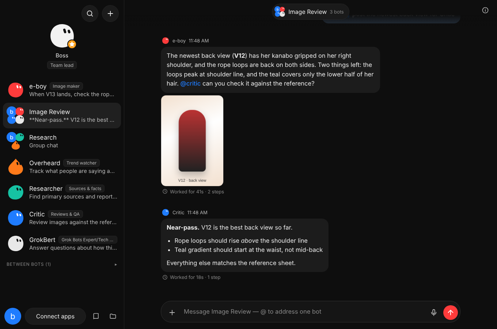
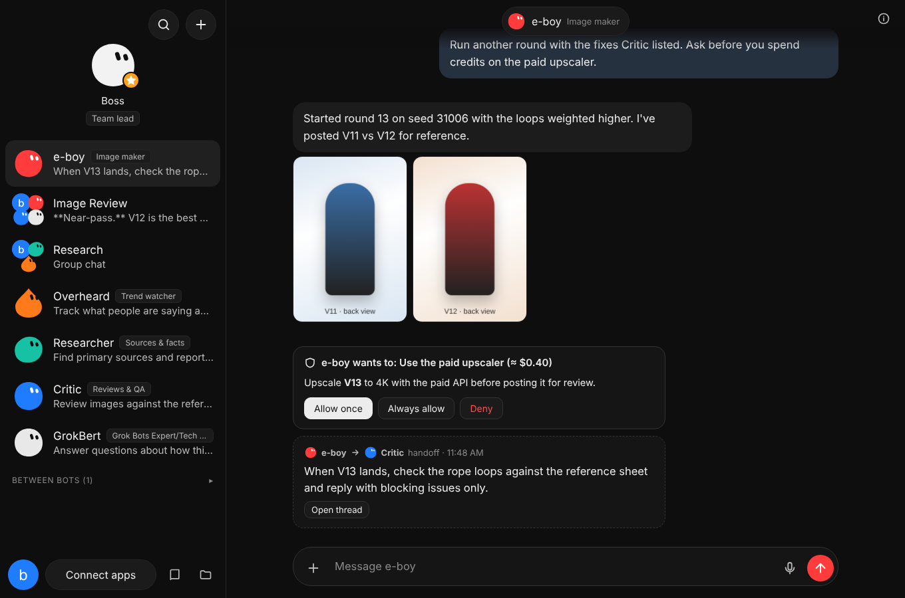

# Cursor Bots

**A Grok-Bot-style team of persistent AI teammates, running on your own Cursor agents.**

Each bot has a name, a job, a picture, its own chat and a memory that persists. All of them share one computer (a workspace folder). They message you and each other, work together in group chats, hand work off, save reusable skills, run routines on a schedule, and stop for your approval before consequential actions.



<sub>Screenshots use seeded demo data.</sub>

Under the hood every bot is a durable [Cursor SDK](https://cursor.com/docs/sdk/typescript.md) agent: Cursor's own agent loop, tools and models. This repo is the **harness** around those agents: identity, memory, messaging, routing, schedules, approvals, secrets and the app.

```
npm install
export CURSOR_API_KEY=key_...      # cursor.com/dashboard → API Keys
npm start                          # prints http://localhost:4777/?token=…  (open it once)
```

No key yet? `npm run demo` starts the same app with a scripted demo brain and a starter team, so you can click through everything.

> New to agent harnesses? Read [docs/ARCHITECTURE.md](docs/ARCHITECTURE.md). It walks through exactly what each bot sees every turn and how messages, memory and handoffs work. [docs/RESEARCH.md](docs/RESEARCH.md) compares Grok Bot, Hermes Agent and OpenClaw, and explains why this is built on the Cursor SDK.

---

## What you get

| Grok Bot feature | Here |
| --- | --- |
| Named bots with a job, label, picture and their own chat | ✔ blob avatars (8 shapes, any color, or upload), pin, hide, sections, duplicate, export/import templates |
| Persistent context | ✔ one durable Cursor agent per bot (`Agent.resume` after restarts) plus a memory file injected every turn |
| Memory ("remember that…") | ✔ lasting rules, preferences, facts and a work log; editable in the bot's details |
| One shared computer (`/workspace`) | ✔ `~/.cursor-bots/workspace` is every bot's working directory: files, CLI logins, browser profile |
| Messaging: attachments, `/skills`, `@mentions`, Reply, your message redirects running work, "Stop now" | ✔ images go to the model directly; up to 6 attachments per message |
| Group chats of 2–6 bots; "bots decide who responds", `@one`, `@everyone` | ✔ plus an optional group lead |
| Async handoffs between bots | ✔ `send_message` → bot-to-bot thread → the reply wakes the requester |
| Skills (one shared library) | ✔ native Cursor/Agent Skills in `.cursor/skills/`; bots save them with `skill_save` |
| Routines on a schedule or webhook; Test; pause; 20-run history | ✔ cron in your time zone, 50 per bot, ≥5 minutes apart, auto-pause after 14 days away |
| Approvals: Allow once / Always allow / Deny | ✔ shell commands via a Cursor hook, other actions via `request_approval` |
| Secure secret card (never shown to the bot) | ✔ encrypted vault, `run_with_secrets`, `${secret:NAME}` in connectors |
| Plugins / Connect apps | ✔ any MCP server (presets: browser, GitHub, Notion, fetch, Linear), per-bot allowlist |
| Bots creating focused helper bots | ✔ `create_bot` |
| Attention states and notifications | ✔ working spinner, unread, needs-you badge, desktop notifications |
| Phone access | ✔ responsive web app; `--host 0.0.0.0` with a token |
| Your *other* agents talking to the team | ✔ **Team MCP** at `/mcp`: Claude Code, the Cursor IDE, Hermes, OpenClaw or any MCP client can `list_bots`, `message_bot` (and wait for the answer), `read_chat`, `create_bot` |
| No model picker | You choose: per-bot brain and model, from your Cursor account or any OpenAI-compatible provider (Featherless, OpenRouter, xAI, Ollama…) |

Not included: a virtual desktop with "watch the computer" and takeover (bots get a real browser through the Playwright connector instead), teach-by-demonstration, voice chat (dictation works), native Slack/X apps, team admin. See [RESEARCH.md §5](docs/RESEARCH.md#5-where-cursor-bots-differs-from-grok-bot).

## Requirements

- **Node.js 22.18+** (it runs the TypeScript sources directly; the Cursor SDK needs 22.13+)
- A **Cursor API key** (user or service-account key) from [cursor.com/dashboard → API Keys](https://cursor.com/dashboard). Usage bills to that Cursor account, like any SDK run.
- *Or* a key for an OpenAI-compatible provider such as Featherless AI, or a local server like Ollama. See [Other models](#other-models-featherless-openrouter-xai-local-servers).
- Linux, macOS or WSL. `npm run doctor` checks your setup.

## Using it

1. **Create a bot** (＋ or Ctrl/⌘ N). Give it a focused job in operational terms ("Own the weekly account-health review… Never contact a customer without approval."). Or click **Add a starter team** on the empty screen: Researcher, Writer, Critic, Builder, plus a "Studio" group.
2. **Give it a first task** with a clear finish line. Watch it work: the typing bubble streams, tool calls show as live chips, and the reply keeps a "Worked for 40s · 9 steps" log.
3. **Teach it lasting rules**: "Remember: never send anything outside this app without asking me." It saves that to memory, which you can read and edit in its details (click its name at the top).
4. **Start a group** (＋ → New group chat), describe the shared outcome, and write normally, or `@critic` one bot. Bots `@mention` each other to hand work along, and you see it happen.
5. **Ask for a handoff from a DM**: "Make V12 and get Critic's opinion." e-boy messages Critic, Critic answers in their thread (under *Between bots* in the sidebar), and e-boy reports back to you.
6. **Save the workflow as a skill**: "Save what we just did as a skill called weekly-report." Reference it later with `/weekly-report`.
7. **Make it a routine**: "Every weekday at 8:45 AM, run /weekly-report and post it here. If the data source is down, tell me instead." Manage routines in the bot's details: pause, **Test**, edit, webhook URL and key, run history.
8. **Approvals**: when a bot wants to `git push`, `rm -rf`, send email, publish…, a card appears. Choose **Allow once**, **Always allow** or **Deny**. Edit the rules in Settings → Approvals.
9. **Connect apps**: add MCP servers (a real browser, GitHub, Notion…). Store their tokens in Settings → Secrets and reference them as `${secret:GITHUB_TOKEN}`.
10. **Give bots a real browser**: Connect apps → **browser**. Each bot gets its own persistent Playwright browser profile in `workspace/.browser/<bot>`, so several bots can browse at once and stay signed in. On a desktop the window is visible, so you can take over for a login. Run `npx @playwright/mcp install-browser chrome-for-testing` once first.
11. **From the terminal**: `node src/cli.ts say critic "is V12 ready?"` streams a bot's reply.
12. **From your other agents**: Settings → *Connect your agents* shows the MCP URL, token and copy-paste config. For example, in Claude Code:
    ```
    claude mcp add --transport http cursor-bots http://localhost:4777/mcp --header "Authorization: Bearer <token>"
    ```
    Then "ask @researcher to dig into this and tell me what it finds" works from inside Claude Code.

House rules for *all* bots live in `~/.cursor-bots/workspace/AGENTS.md` (Shared computer → AGENTS.md).

### Other models: Featherless, OpenRouter, xAI, local servers

Bots don't have to run on Cursor. Any service with an OpenAI-compatible chat API can be a **brain**, and each bot picks its own brain and model in its details. You can mix them on one team: Cursor for the builder, an open model for the researcher.

1. Settings → **Brain & models** → *Providers* → pick a preset: Featherless AI, OpenRouter, xAI, OpenAI, Groq, Together, DeepInfra, Ollama, LM Studio, or *Other* for any OpenAI-compatible URL.
2. Paste the API key and click **Save and test**. The key is write-only: it is stored encrypted in its own vault, never shown again, never logged and never sent to the bots. It is only sent to the address it was saved for: point the provider at another host and you're asked for the key again. You can also set it in the environment instead (`FEATHERLESS_API_KEY`, `OPENROUTER_API_KEY`, …). The gateway reads it once, removes it from the environment bots' commands get, and scrubs it from tool output. Saving it in the app is still safer: any program running as your user can read the environment a process started with (on Linux, `/proc/<pid>/environ`). The harness blocks the obvious ways to do that, but bots run as you.
3. Add models by id or search the provider's catalogue from the editor. Context size, reply length and (for Featherless) concurrency cost are filled in from the catalogue.
4. In a bot's details, choose the provider as its brain, then a model. Or make it the default brain for every bot that hasn't picked one.

**Featherless AI.** Set *Concurrency* to your plan's units (the Chat plan has 4; a 32B model costs 2 of them, a 70B model 4). Bots then queue for a slot instead of hitting 429 errors. A model that hasn't been used for a while is "cold": the first request can take minutes while Featherless loads it. The bot shows "warming up" and retries. Native tool calling is documented for the Qwen 3 family and Kimi-K2. For other models, set the tool mode to *Auto* (the default) or *Prompt*, and the runtime writes the tools into the prompt and reads tool calls back from the text.

**What changes on a provider brain.** Cursor brings its own tuned agent: file tools, codebase indexing, context compaction and an optional sandbox. A plain model API brings only "messages in, text and tool calls out", so for these brains the harness supplies the rest:
- its own shell, file, search and web-fetch tools, with the same approval rules;
- its own MCP client for Connect apps;
- its own transcript and context compaction, with summaries when the conversation outgrows the model's window.

Open models vary a lot in how well they call tools and how much context they hold. A 32B model with a 32k window can do focused tasks well, but long multi-step work goes better on a larger model.

`node src/cli.ts models --runtime featherless --search qwen` lists a provider's catalogue from the terminal, and `npm run doctor` checks each provider's models and its key (with one short test prompt).

### Run it 24/7

Bots only work while the gateway runs. For Grok-Bot-style "keeps working while my laptop is closed", run it on an always-on machine:

```ini
# /etc/systemd/system/cursor-bots.service
[Unit]
Description=Cursor Bots
After=network-online.target

[Service]
WorkingDirectory=/opt/cursor-bots
Environment=CURSOR_API_KEY=key_...
ExecStart=/usr/bin/node src/cli.ts start --host 0.0.0.0 --port 4777
Restart=on-failure
User=bots

[Install]
WantedBy=multi-user.target
```

The app always requires its access token, which is printed on start (`http://host:4777/?token=…`) and stored in `state/ui.token`. Your browser keeps it in a cookie after the first visit. Put the app behind HTTPS (Caddy, Tailscale, Cloudflare Tunnel) before exposing it beyond your network.

## Configuration

| | |
| --- | --- |
| `CURSOR_API_KEY` | Cursor API key used by every bot (a login stored by the Cursor SDK in `~/.cursor/sdk/auth.json` works too) |
| `CURSOR_BOTS_HOME` / `--home` | Where everything lives (default `~/.cursor-bots`) |
| `--port`, `--host` | Web/API address (default `127.0.0.1:4777`) |
| `--runtime cursor\|mock\|<provider>` | Default brain (saved to settings) |
| `FEATHERLESS_API_KEY`, `OPENROUTER_API_KEY`, … | A provider's key, used when none is saved (read once, removed from the environment bots' commands get; saving it in the app is safer) |
| `--starter` | Create the starter team on first run |
| `--open` | Open the app in your browser on start |
| `CURSOR_BOTS_TOKEN` | Force a specific access token (removed from the environment bots inherit) |

Everything else is in the app's Settings: your name and label, time zone, default and routing models, group routing, approval mode and rules, Cursor Auto-review and sandbox, limits, secrets.

## Security model

- Bots run with **your** permissions on the machine running the gateway, inside the shared workspace by convention (not by enforcement). For stronger isolation, run the gateway in a container or VM, or enable the Cursor sandbox in Settings (note: with the sandbox or Auto-review on, the Cursor SDK refuses connector/MCP tool calls in local runs).
- Like Grok Bot's shared computer, **every bot can read every file and use every login** on that machine or workspace. Keep credentials in Secrets, not in files.
- Consequential shell commands stop for approval. The rules are regexes you control. The hook fails *open* if the gateway is down, so it never blocks you from using Cursor yourself in that folder.
- Text from web pages, files and other bots is treated as data, and the bots' manual says so. Prompt injection is still possible, so keep external actions behind approval.
- The API needs the access token even on localhost, so a bot can't `curl` its own approval endpoint. It also refuses cross-origin writes.
- Harness integrity guards (best effort, enforced by the workspace hooks): bots are blocked from shell commands that call the gateway's port or touch `~/.cursor-bots/state` or the hook files, and from file tools that read or write the gateway's state, settings, checkpoints, the hook script, `hooks.json`, the manual rule or Cursor's permission and MCP config (symlinks are followed, including links inside a folder being searched). The gateway rewrites changed hook files before every turn, and moves any `workspace/.cursor/mcp.json` into `state/quarantine/` because Cursor would start its servers without approval; add MCP servers in Connect apps. Bots run as your OS user and these checks match command text, so this raises the bar but isn't a sandbox. Secret values are never put in prompts or chats, but a deliberately malicious process running as you could still read the vault.

## Project layout

```
src/
  cli.ts                 start | doctor | models | say
  server/http.ts         REST API, SSE events, uploads, webhooks, Cursor hook endpoints
  server/mcp.ts          Team MCP endpoint for outside agents
  core/harness.ts        the gateway: roster, conversations, routing, handoffs, approvals, secrets
  core/runner.ts         one per bot: priority queue, steering, the turn loop
  core/prompt.ts         the per-turn envelope (identity, memory, team, context)
  core/manual.ts         the operating manual every bot follows (an always-on Cursor rule)
  core/tools.ts          harness tools exposed to bots as Cursor custom tools
  core/memory.ts, skills.ts, scheduler.ts, approvals.ts, secrets.ts, store.ts, workspace.ts
  core/providers.ts      provider presets and validation (Featherless, OpenRouter, xAI, local servers…)
  core/workspace-tools.ts  shell, file, search and fetch tools for brains without their own
  core/mcp-client.ts     MCP client (stdio, Streamable HTTP, legacy SSE) for brains without one
  runtimes/cursor.ts     Cursor SDK local agents
  runtimes/openai.ts     any OpenAI-compatible chat API: agent loop, tool calling, compaction
  runtimes/mock.ts       scripted demo/test brain
web/                     the app (vanilla JS, no build step)
test/                    node:test suite (npm test)
docs/                    RESEARCH.md, ARCHITECTURE.md
```

## Development

```
npm run dev        # restart on change
npm test           # full suite on the demo brain
npm run typecheck  # against the real @cursor/sdk types
```
